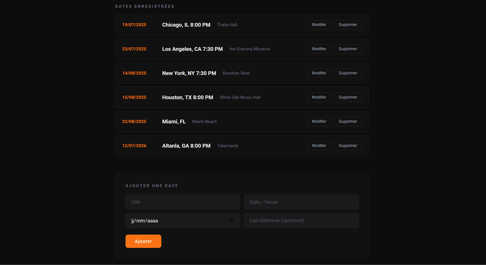

# Isaiah Rashad — site d'artiste avec espace d'administration (front)

> Site vitrine d'un artiste, avec un **espace d'administration sécurisé** pour gérer les dates de tournée. Le front est en JavaScript « vanilla » (sans framework) et consomme une **API REST Symfony** que j'ai développée.

🔗 **Site en ligne** : [isaiah-rashad.vercel.app](https://isaiah-rashad.vercel.app)
🧩 **API (back-end)** : [isaiah-rashad-api](https://github.com/emilie-tankou/isaiah-rashad-api)
⏱️ L'API est hébergée gratuitement : la première visite après une période d'inactivité peut prendre jusqu'à une minute.

## Aperçu




<!-- Vidéo de démonstration : en modifiant ce fichier sur github.com, glissez le fichier .mp4 à cet endroit ; GitHub insère lui-même le lien. -->

## Tester la démo

1. Ouvrez le site : les dates de tournée sont chargées depuis l'API (la première visite peut prendre jusqu'à une minute).
2. Descendez avec la flèche et passez la souris sur la pochette de l'album.
3. L'espace d'administration (ajout, modification et suppression de dates) est protégé par un mot de passe : il est présenté dans la vidéo de démonstration, et les identifiants sont fournis sur demande.

## Un projet en deux dépôts

```
Navigateur ──► Front (Vercel)  ──► API Symfony (Render) ──► PostgreSQL (Neon)
 isaiah-rashad.vercel.app          isaiah-rashad-api
 ce dépôt                          JWT, validation, CORS
```

## Fonctionnalités

- **Page publique** : présentation de l'album, playlist, dates de tournée chargées depuis l'API (avec « Voir plus »), actualités et boutique
- **Connexion administrateur** : email et mot de passe, l'API renvoie un jeton JWT
- **Espace d'administration** : ajouter, modifier et supprimer une date, avec des messages d'erreur clairs
- Redirection automatique vers la connexion quand la session expire
- Animations : indicateur de défilement sur l'accueil et effet 3D sur la pochette, qui suit la souris (désactivé sur écran tactile et pour les personnes qui réduisent les animations)
- Messages d'attente pendant le réveil du serveur gratuit

## Stack

HTML5 · CSS3 · JavaScript (modules ES, `fetch`) · API REST Symfony (JWT, PostgreSQL) · hébergement Vercel

## Structure

```
├── index.html      page publique
├── login.html      connexion
├── admin.html      espace d'administration
├── config.js       adresse de l'API (locale sur votre poste, hébergée une fois en ligne)
├── api.js          fonctions communes : appels à l'API, jeton, protection XSS
├── script.js       affichage public des dates
├── login.js        connexion
├── admin.js        création, modification, suppression
├── parallax.js     effet 3D de la pochette
├── style.css
└── images/
```

## Points techniques

- **Protection contre le XSS** : tout texte reçu de l'API est échappé avant d'être inséré dans la page, et seuls les liens `http(s)` sont acceptés
- **Gestion du jeton JWT** : stocké dans `sessionStorage` (il disparaît à la fermeture de l'onglet) et envoyé dans l'en-tête `Authorization` ; une réponse `401` renvoie automatiquement à la connexion. Le compromis : un jeton lisible par le JavaScript est exposé en cas de faille XSS, d'où l'échappement systématique
- **Un seul écouteur d'événements** pour tous les boutons de la liste (délégation), au lieu de code `onclick` écrit dans le HTML
- **Gestion des erreurs** : message clair quand le serveur est indisponible ou quand la validation refuse des données
- **Adresse de l'API choisie automatiquement** : l'API locale sur `localhost` / `127.0.0.1`, l'API hébergée ailleurs

## Lancer en local

1. Démarrez l'API (voir le [README de l'API](https://github.com/emilie-tankou/isaiah-rashad-api)) sur `http://127.0.0.1:8000`.
2. Ouvrez ce dossier dans VS Code et lancez `index.html` avec l'extension **Live Server** (adresse `http://127.0.0.1:5500`).

> Il faut passer par un serveur local : ouvrir le fichier directement dans le navigateur (`file://`) bloque les modules JavaScript et les appels à l'API.

## Déploiement

Le site est un ensemble de fichiers statiques déployé sur **Vercel** : chaque `git push` sur la branche `main` redéploie automatiquement le site. Pour qu'il puisse appeler l'API, l'adresse du site doit figurer dans la variable `CORS_ALLOW_ORIGIN` de l'API.

## Difficultés rencontrées

- **CORS** : le navigateur bloquait les appels du site vers l'API. Il a fallu autoriser côté API l'adresse exacte du site, y compris les adresses de déploiement de Vercel
- **Sensibilité à la casse** : une image (`vinylshop.png` au lieu de `Vinylshop.png`) et un lien d'ancre (`#dates` au lieu de `#Dates`) fonctionnaient sous Windows mais pas sur le serveur de production
- **Réveil du serveur gratuit** : ajout de messages d'attente pour que la première visite ne ressemble pas à une panne

## Évolution du projet

La première version utilisait **Firebase** (Firestore et Authentication). Je l'ai remplacée par une API Symfony avec une base PostgreSQL, pour maîtriser toute la chaîne : modèle de données, validation, sécurité et déploiement. Ce choix m'a fait comprendre ce qu'un service géré fait à ma place, et ce qui revient au développeur quand on le retire.

## Pistes d'amélioration

- Tests automatisés de l'interface
- Mise à jour de la liste des dates en temps réel (avec Firebase, c'était automatique)
- Optimisation des images (formats modernes, tailles adaptées)

## Avertissement

Projet pédagogique, sans lien avec l'artiste. Les images et logos sont utilisés à titre d'illustration, sans usage commercial.

## Auteure

Emilie Tankou — [@emilie-tankou](https://github.com/emilie-tankou)